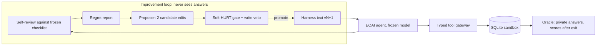

<div align="center">
  <h1>EOAI × GUARD</h1>
</div>

<div align="center">
  <h3>A pre-registered, blind test of whether GUARD's regret-guided
  self-improvement makes a tool-calling agent better, with every
  failure kept in the record.</h3>
</div>

<div align="center">
  
  
  
  
  <a href="https://github.com/Aaryan1524/EOAI/actions/workflows/tests.yml"></a>
</div>

<br>

EOAI is a stateful enterprise-operations agent: it resolves customers,
pages through invoices, applies contract amendments and creates
escalation tickets in an isolated SQLite sandbox. On top of it sits an
independent implementation of
[GUARD](https://arxiv.org/abs/2611.23476), a method that improves an
agent by rewriting its instruction text, guided by self-review and a
regression gate. A deterministic oracle that no learning component can
see scores the agent before and after. GUARD is compared against no
improvement and against naive self-improvement.

```sh
uv sync --locked --extra test --no-install-project && PYTHONPATH=src:. .venv/bin/python -m pytest -q
```

> [!NOTE]
> This is an independent implementation built from the paper, not the
> authors' code, and every model role ran on a 4B local model. The
> results describe **this implementation at this scale**, not GUARD in
> general. See [Known gaps](#known-gaps).

## Headline result

**GUARD showed limited or conditional benefit.** On 30 fresh tasks
(3 trials each), scored by the independent oracle:

| Arm | Pass rate | vs frozen | p (sign-flip) |
|---|---|---|---|
| Frozen EOAI | 76.7% | | |
| Naive self-improvement | 82.2% | +5.6 pp | 0.13 |
| **GUARD** | **85.6%** | **+8.9 pp** | **0.094** |
| GUARD without the write veto | 84.4% | +7.8 pp | 0.063 |

- **Real but small gains.** Every adaptive arm improved on frozen; none
  reached the pre-registered p < 0.05, and most of the gain came from
  one task family (paged review: 6.7% → 53.3%).
- **GUARD vs naive was a wash.** +3.3 pp, p = 0.56. Its distinctive
  machinery did not measurably beat plain self-improvement here.
- **The self-reviewer is the weak link.** It never passed a wrong run,
  but it failed 32% of runs the oracle judged correct.
- **It hit scaling walls.** At the pre-registered 20 + 10 task buffer
  GUARD could not run at all; on the reduced buffer, 2 of 6 runs
  aborted when the proposer kept repeating a rejected edit.
- **No arm caused harm.** No unwarranted ticket or source-data write in
  any run.

Full analysis: [`docs/comparative-report.md`](docs/comparative-report.md).

## Why I built this

I wanted to know whether GUARD's extra machinery (regret-ranked
feedback, contrastive prompt evolution, the Soft-HURT regression gate)
earns its cost on an agent doing real multi-step work, scored by
something other than the improver itself. Most self-improvement
results I had read are graded by the same model that did the
improving, so a stricter or more lenient reviewer moves the headline.

So I built the agent first. Milestones 1–6 cover the domain, tools,
runtime, hardening, compound workflows and replay. Money, dates,
permissions and write safety are enforced in code, never by the model.
Only then did I implement GUARD from the paper and run two adversarial
audits against it (kept in [`audit/`](audit/guard-phase1/)). After
that I locked a pre-registration and ran the comparison. Every failure
stays in the record: the aborts, both amendments, and the analysis
bugs I fixed after seeing results.

## How the study works



**What can change.** Only the harness, three strings: `instructions`,
`skills`, `memory`. Each proposal adds one bounded `[iff condition]`
rule. The model, tools, budgets, policies and fixtures are frozen and
checked by digest on every run.

**Arms.** All four start from the same harness and share one frozen
self-review checklist and one baseline batch per trial.

| Arm | What it does |
|---|---|
| A. Frozen | No adaptation |
| B. Naive | Reflect on failed tasks, propose 2 edits with GUARD's own proposer prompt, always promote the best training score. No ranking, replay or gate. |
| C. GUARD | `experiments/guard/loop.py`, unchanged from the audited revision |
| C′. GUARD without veto | C with only the mandatory-write veto removed. It shares C's sampling seeds, so the veto is the only systematic difference. |

Budgets for B, C and C′: 3 rounds, 2 candidates per round, 1
replicate. GUARD's gate settings are a noise floor of 15 points, a
hurt budget of 1 task, a margin of 1.5 and 1 repair.

**Data.** I wrote a seeded generator (`experiments/comparative/fixtures.py`,
seed 20261120) covering six task families: inventory, review,
amendment conflict, single escalation, account escalation, and paged
review. Every case gets its own tenant and SQLite lineage. Each
expected outcome comes from a hand calculator and is cross-checked
against the frozen policy engine.

| Split | Size | Seen by |
|---|---|---|
| Adaptation | 20 pre-registered, 6 used | B, C, C′ (answers blanked) |
| Gate / replay | 10 pre-registered, 4 used | C, C′ only |
| Dev-eval | 30 | the oracle only |

**Scoring.** The oracle is plain code. It compares the final database
state, created tickets and final report against the private
expectations, after the agent process has exited. Each arm's final
harness runs every dev-eval task once per trial over 3 trials, and the
task is the unit of analysis. An aborted arm is scored as frozen
(intention to treat). Differences are tested with an exact sign-flip
permutation test over tasks, plus a percentile bootstrap CI. The
conclusion is picked by a rule written down in advance.

---

## Documentation

- **[Comparative report](docs/comparative-report.md)**: results,
  answers to the six research questions, failures, deviations,
  reproduction commands.
- **[Pre-registration](docs/comparative-preregistration.md)**: the
  locked protocol and both amendments.
- **[Roadmap](docs/roadmap.md)**: what is weak, what to test next, and
  how v2 will be run.
- **[GUARD implementation](docs/guard-phase-1.md)** and
  **[audit remediation](docs/guard-phase-1-remediation.md)**: how the
  paper was mapped to code, and what two adversarial audits changed.
- **[Naive arm review](docs/comparative-naive-review.md)**: separate
  review of the baseline self-improvement arm.
- **[Sandbox and agent guide](docs/eoai-sandbox.md)**: tools, runs,
  replay, the `ops-agent` CLI.
- **[Design record](docs/milestone-0-design.md)**: entities,
  invariants, tool contracts, threat model.
- **[Evaluation harness](experiments/README.md)**: the independent
  evaluator and held-out isolation.

All docs are indexed in [`docs/README.md`](docs/README.md).

## Directory layout

```
EOAI/
├── src/enterprise_ops/        the agent and its world
│   ├── domain/                money, dates, contract terms, policy (deterministic)
│   ├── storage/               SQLite schema and migrations
│   ├── sandbox/               snapshots, clones, reset, seeded fault injection
│   ├── tools/                 typed gateway, 18 tools, authorization, write protocol
│   ├── agent/                 runner, model adapter, output schema, harnesses v1–v3
│   └── fixtures/              synthetic tenants and task catalog
├── experiments/
│   ├── eoai_eval/             independent oracle and held-out runner (never seen by learners)
│   ├── guard/                 GUARD: review, regret, proposals, Soft-HURT gate, roles
│   ├── comparative/           the blind study: fixtures, naive arm, runner, analysis
│   └── datasets/              manifest schemas
├── docs/                      reports, pre-registration, design records
│   └── comparative-results/   committed analysis JSON (no answers inside)
├── audit/guard-phase1/        two adversarial audits and the preflight
├── tests/                     416 tests: domain, tools, runner, GUARD, isolation
└── runs/                      run artifacts (git-ignored)
```

### Why the agent and GUARD live in separate packages

`src/enterprise_ops` must not contain any self-improvement logic, and
nothing in it may import `experiments`. GUARD can only change three
strings (`instructions`, `skills`, `memory`); it cannot touch tools,
budgets, policies or fixtures. That boundary is what makes "the
harness got better" a meaningful claim.

### Why the answers live outside the repo

Fixture answers for the study are generated into
`~/EOAI-private/comparative-v1` (mode `0700`). Adaptation components
receive cases with expectations blanked; only the oracle reads the
private directory, after the agent has exited. The sealed final suite
was never opened during this study.

### Why GUARD's files are pinned by digest

The study asks about GUARD *as audited*, so `experiments/guard/` is
byte-identical to the audited revision and every phase re-checks the
digests. Fixing GUARD's scaling problems therefore belongs in a new,
labelled variant, not an edit. See the [roadmap](docs/roadmap.md).

## Setup

### 1. Install

Python 3.12+ and [uv](https://docs.astral.sh/uv/).

```sh
git clone https://github.com/Aaryan1524/EOAI.git && cd EOAI
uv sync --locked --extra test --no-install-project
PYTHONPATH=src:. .venv/bin/python -m pytest -q     # 416 passed
```

No model is needed for the test suite. On non-macOS hosts the
Seatbelt process-isolation tests are skipped.

### 2. Install the pinned model (for live runs only)

```sh
ollama pull qwen3:4b-instruct
ollama list | grep 0edcdef34593     # the pinned digest
OLLAMA_NUM_PARALLEL=1 ollama serve
```

The runners verify the model digest around inference and refuse a
different build of the same tag.

### 3. Try the agent

```sh
uv pip install -e .
source .venv/bin/activate
ops-agent tasks
ops-agent seed baseline
ops-agent run baseline --task acme-account-escalation --id acme-dev --harness v3 --authorize-writes
ops-agent inspect acme-dev
```

Expected: one verified new ticket, one preserved active ticket, no
action for the disputed or settled invoices.

### 4. Reproduce the study

Takes several hours on one laptop. **Keep `--out` outside the repo**,
because it holds the answers.

```sh
export PYTHONPATH=src:.
.venv/bin/python -m experiments.comparative.fixtures --out ~/EOAI-private/comparative-v1
./experiments/comparative/run_all.sh 3 amend1 runs/comparative/amend2 300
.venv/bin/python -m experiments.comparative.analyze \
  --trial runs/comparative/amend2/trial-{1,2,3} \
  --deveval runs/comparative/amend2/deveval-{1,2,3} \
  --out runs/comparative/amend2/analysis.json
```

Compare against
[`docs/comparative-results/amend2-analysis.json`](docs/comparative-results/).
Exact numbers can drift with Ollama or hardware versions; the
provenance records which ones produced the published run.

## Usage

| Command | What it does |
|---|---|
| `ops-agent run / inspect / replay / reset` | Run one task, read its trace, replay under another harness, reset a sandbox |
| `python -m experiments.comparative.runner validate` | Check the three private splits are disjoint (no model calls) |
| `… runner calibrate` | Live reviewer calibration on the six catalog fixtures |
| `… runner trial --trial N --buffer amend1` | One trial: shared baseline, then naive, GUARD, GUARD-no-veto |
| `… runner deveval --trial-dir DIR` | Oracle-only scoring of each arm's final harness |
| `python -m experiments.comparative.analyze` | Statistics, gate audit, self-review confusion, cost |

## Known gaps

- **Independent implementation.** GUARD here follows arXiv v1 but was
  written for this project. Some limits (the 128 KiB role-payload cap,
  aborting after two repeated proposals) are this implementation's
  choices and may not match the authors' system.
- **One small model in every role.** Solver, reviewer, proposer and
  distiller are all `qwen3:4b-instruct`. A stronger reviewer and
  proposer is the most likely way to change the result, and is the
  first v2 experiment.
- **Low statistical power.** 30 tasks × 3 trials reliably detects only
  gains of roughly 15–20 points.
- **Reduced buffer.** The headline uses a 6 + 4 task buffer (Amendment
  1) because GUARD could not run at the pre-registered 20 + 10.
- **Uneven evidence.** GUARD's proposer sees gate-task feedback; the
  naive arm does not.
- **Synthetic, six-family workload.** Real operations are messier.
- **macOS for full isolation.** Held-out worker isolation uses Seatbelt
  and fails closed elsewhere.

## Troubleshooting

```sh
curl -s localhost:11434/api/version          # is Ollama up?
ollama list | grep qwen3:4b-instruct         # pinned digest 0edcdef34593?
cat runs/comparative/<dir>/trial-1/guard/status.json   # why an arm stopped
```

**`ValueError: Invalid or oversized role prompt`**: GUARD's regret
report exceeded the 128 KiB relay cap. It grows with the number of
buffer tasks (about 137 KB at 30 tasks). Use a smaller buffer; this is
the reason for Amendment 1.

**`ModelError: Ollama request timed out`**: a role call exceeded the
timeout. Large prompts on a local 4B model can take more than 90 s;
pass a role timeout of 300 as the fourth `run_all.sh` argument.

**`Candidate pool repeats a revision or a previously rejected
harness`**: the proposer produced an already-seen harness three times
in a row. In the locked study this aborts the arm, and the arm is scored
as frozen (intention to treat).

**Two isolation tests fail with `realpath: ... Operation not permitted`**:
the Seatbelt profile is checked against uv-managed CPython. Homebrew
Python's framework layout falls outside it. Recreate the venv with
`UV_PYTHON=3.12.14 UV_PYTHON_PREFERENCE=only-managed uv sync --locked --extra test --no-install-project`.

**Held-out command refuses to start on Linux**: worker isolation needs
macOS `sandbox-exec`. This is intentional fail-closed behaviour.

## Uninstall

```sh
rm -rf .venv runs
rm -rf ~/EOAI-private/comparative-v1     # private fixtures and answers
ollama rm qwen3:4b-instruct
```

## Project history

1. **Agent before optimizer.** Milestones 1–6 built the domain,
   tools, runtime, hardening, compound workflows and replay before any
   GUARD code, so the subject of the study was trustworthy first.
2. **Shared scorer → independent oracle.** Baseline experiments
   (PR #8) moved scoring into a separate package with private answers;
   held-out workers were then process-isolated (PR #9).
3. **Pilot → audit → remediation.** The first GUARD pilot (PR #10)
   promoted a harness on a false 100/100 review. An adversarial audit
   caught it; PR #11 fixed action obligations, review uncertainty and
   proposal grounding, and a re-audit approved it for comparison.
4. **20 + 10 buffer → 6 + 4.** GUARD's regret payload outgrew its
   128 KiB role cap (Amendment 1).
5. **90 s → 300 s role timeout.** Round-2 proposals on the local model
   took longer than 90 s (Amendment 2).

## Citation

If you use this work, cite it with [`CITATION.cff`](CITATION.cff)
(GitHub's "Cite this repository" button).

## License

[Apache-2.0](LICENSE).
