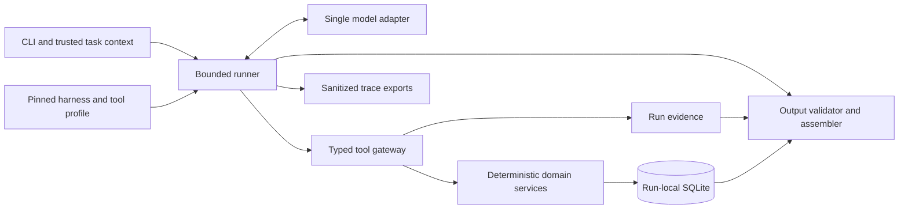
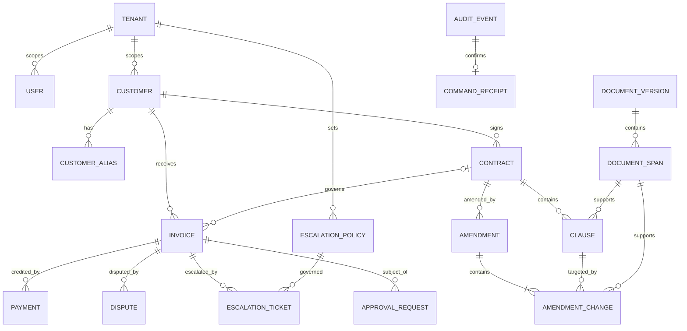

# Milestone 0 — Enterprise Operations Agent design

**Status** · Reviewed for Milestone 1

**Scope** · Architecture, data model, tool and execution contracts, threat model, and acceptance plan for a synthetic sandbox.

## Architecture decisions

| Decision | Rationale and tradeoff |
|---|---|
| One Python process, one tool-calling model, one SQLite copy per run | The CLI loads a named synthetic fixture, pins the model and harness, and opens a private database copy. A bounded loop calls a typed in-process gateway. The gateway works with deterministic domain services and SQLite. This keeps concurrency at the one boundary that needs it, the database. |
| One database for records, versioned document spans, approvals, and mutation audit | Store synthetic source text alongside structured terms. The policy service resolves the structured terms, and the model can inspect their exact supporting excerpts. Storing both together lets a write check evidence availability in the same transaction. Stable spans suffice for the initial fixture sizes. |
| A trusted write scope supplied alongside the natural-language request | The host grants a scope through the synthetic task envelope or explicit CLI inputs. The model can discover and propose work inside that scope. For free-form requests lacking a scope, the agent can investigate and ask for confirmation. This adds friction to ad hoc writes and makes the authorization boundary testable even when retrieved text controls the model. |
| One active escalation per tenant and invoice | `open` and `in_progress` are active. The applicable policy ID and version are recorded for provenance. A policy update cannot open a second active ticket. A new request and fresh evaluation can create a ticket after the previous one resolves. |
| A tenant revision for preview and pagination, plus row versions | A revision bump detects changes to related payment, dispute, contract, or ticket records without a dependency graph. A write elsewhere in the same tenant can invalidate a cursor or preview. Restart or re-preview within budget. Separate tenant revisions contain cross-tenant interference. |
| One declared tool profile per run | Pin the profile and hash of its declarations. A later v2 profile maps its own arguments and pagination to the same domain services. Historical runs retain their original contracts. Start with v1 and one model adapter. |
| Version the instructions and isolate evaluation inputs | Archive the exact rendered harness and declaration hashes. Preserve earlier harnesses, the model pin, tool and policy code, snapshots, and evaluation rules as independent inputs. Future private expected outcomes are held outside the runner's filesystem and tool namespace. |



Python 3.12+, SQLite, Pydantic-generated tool schemas, and pytest are proposed. A provider stub and deterministic scripted client exercise the runtime boundary before a live model is introduced. The model can interpret intent, select tools, compare excerpts, and draft explanations. Code owns authority, identity scoping, arithmetic, term precedence, state transitions, and action receipts. The design uses one prompt-guided loop and plain domain functions. Workflow graphs, separate document infrastructure, event sourcing, and an additional model reviewer each need a demonstrated use case.

## Data model

Use opaque IDs. Every tenant-owned table has a tenant-scoped key, with composite foreign keys on all relationships. Include customer in the invoice-to-contract foreign key so a same-tenant invoice cannot reference another customer's contract. Enable foreign-key enforcement per connection. Mutable rows carry monotonically increasing versions, and every transaction changing tenant business state increments that tenant's revision once. Store instants as canonical UTC timestamps and contractual dates as calendar dates. Each tenant declares an IANA timezone.

| Entity | Key fields and constraints |
|---|---|
| `Tenant` | ID, name, timezone, optional default policy ID and version, state revision. The pair references an immutable policy version in the same tenant. A missing head blocks eligibility. |
| `User` | ID, tenant, role, active flag, version. Roles map to explicit capabilities. |
| `Customer`, `CustomerAlias` | Customer ID, legal name, status, version. Normalized aliases map many-to-many across customers within the tenant. An alias may be ambiguous. |
| `Invoice` | ID, customer, nullable governing contract, issued instant, stated due date, currency, total minor units, lifecycle state, version. Missing contract linkage can be investigated and blocks escalation when terms are unresolved. |
| `Payment` | ID, invoice, kind (`payment\|credit\|reversal`), status, amount in positive minor units, currency, posted instant, optional reversal target, version. A posted reversal can apply once to a payment or credit posted at a strictly earlier instant for the same invoice, currency, and amount. |
| `Dispute` | ID, invoice, opened instant, optional closed instant, reason, version. The interval `[opened_at, closed_at)` determines activity. Any active dispute can block escalation. |
| `Contract`, `Clause` | Contract ID, customer, signing/lifecycle status and dates, issue-date coverage window, designated source document version, row version. Clause ID, contract ID, type, typed terms, optional span in the contract's designated document version, row version. Absent source evidence produces `needs_review`. |
| `Amendment`, `AmendmentChange` | Amendment ID, contract, signature/status, activation date, issue-date applicability window, precedence, designated source document version, row version. Each change names one clause through a same-contract foreign key, replacement values, and an optional span in the amendment's designated document version. |
| `DocumentVersion`, `DocumentSpan` | Immutable (document ID, version), title, kind, fixture source URI, content hash. Span ID with coordinates in canonical text. Span access inherits document tenant scope. |
| `EscalationPolicy` | ID, version, strict overdue threshold, excluded invoice/customer states, dispute rule, approval requirement boolean. The tenant selects an exact version. Existing tickets retain their original version when the tenant changes its selection. |
| `EscalationTicket` | ID, invoice, policy ID/version, lifecycle status, reason code, creator, created instant, version. Partial unique index on (tenant, invoice) for active states. |
| `ApprovalRequest` | ID, invoice, requester, action type, scope and decision-basis digests, status, optional approver, creation/expiry/decision instants, version. At most one pending request for the same requester, scope, and basis. |
| `CommandReceipt`, `AuditEvent` | The receipt stores scoped idempotency key, canonical request fingerprint, authoritative action/result ID, and audit ID. The append-only audit records actor, run and call IDs, reason and evidence, before/after, observed time, and revision. Both persist atomically with the mutation. |



**State transitions.** Invoice lifecycle is `draft → issued → void/cancelled`, with cancellation also allowed from draft. Unpaid, partial, and paid are derived financial states. Dispute activity is independent of invoice lifecycle and balance. A dispute opens and closes once per row. Payments move from pending to posted or failed, with corrections represented as separate ledger entries. Tickets move `open → in_progress → resolved → closed`, with direct resolution allowed from open. No reopening in v1. Approvals move `pending → approved/rejected/expired`; an approved grant is usable only before expiry and while its decision basis still matches. The agent's write capabilities are ticket creation and approval request. Other transitions run through guarded simulator services in test or supervisor contexts.

### Deterministic decisions

1. **Identity and scope.** Tenant and principal come from the host. Reads are tenant-scoped. An exact unique legal-name match can disambiguate an alias search in the demo. Tied identities need a stable account ID or clarification. The write scope binds an existing customer ID and can narrow to specific invoice IDs. A readable record or a model-supplied ID confers no authority.
2. **Time and money.** Freeze one simulation instant per run. The business date is its date in the tenant timezone. Invoice dates, thresholds, and calendar rules use local dates. Payment and dispute event comparisons use instants. Balance is the invoice total less posted payments and credits as of the instant, plus valid posted reversals, floored at zero. Pending, failed, and future postings contribute zero. A successfully loaded empty ledger has zero settled. An unavailable or inconsistent ledger, unsupported adjustment, or currency mismatch yields `needs_review`. Never aggregate unlike currencies.
3. **Contract terms.** Start with the linked contract covering the invoice issue date and signed by the evaluation instant. A terminated contract can govern historical invoices within its explicit issue-date window. Require a single supported payment clause and matching source span. V1 supports calendar `net_days`, optional `grace_days`, and an optional next-weekday adjustment. Compute the effective date by adding net and grace days to the local issue date, then applying the adjustment. Unsupported calendar rules, including holiday adjustments, yield `needs_review`. A difference from the invoice's stated due date is reported with both sources.
4. **Amendments.** Use signed, activated changes that target that clause and cover the invoice's issue date in an inclusive-start, exclusive-end window. By default the window starts at activation. A fixture can explicitly specify earlier issue dates for retroactivity. An issue-date window ending leaves covered invoices on the amended terms. For each changed field, apply the highest explicit precedence. Identical top-priority values can share citations. Conflicting values, unresolved ordering among competing changes, missing spans, or contradictory source metadata produce `needs_review`. Recency alone grants no precedence.
5. **Eligibility and approval.** Days overdue equals business date minus effective due date in calendar days. Both policy and request thresholds must pass. “More than 30 days” excludes day 30. Draft, void, cancelled, future-issued, and fully settled invoices cannot be escalated. Apply tenant exclusions and block active disputes whenever either policy or the trusted request requires it. Eligibility, duplicate-ticket detection, and approval are separate checks. Analysts can create eligible routine tickets when granted the capability. For policy-flagged cases they request approval. A separate supervisor path decides it, with no self-approval. Re-evaluate before using an approved grant. The decision-basis digest covers the action, scope, relevant qualified and blocking source sets and versions, policy, and business date. It excludes the grant's own changing status. A pending request can be the final outcome of a run. Across-run approval resumption requires a future persistent sandbox workflow.

## Tool interface

Logical names below are stable. The adapter maps them mechanically to provider-compatible names. Each handler receives a host-injected run context with sandbox, principal, tenant, clock, profile, and optional action scope. The model supplies only the listed arguments. Use strict, closed request and response schemas. IDs and opaque tokens have bounded lengths. Text and page size are bounded. Paged calls take optional `limit` and `cursor`, defaulting to 10 items with a maximum of 25.

| Tool | Arguments | Success payload |
|---|---|---|
| `clock.now` | None | Simulation instant, tenant timezone, business date. |
| `customer.search` | Query, page | Tenant-local candidates with ID, legal name, match kind, and status. |
| `customer.get` | Customer ID | Canonical record, aliases, version. |
| `invoice.search` | Customer ID, optional lifecycle states, page | Invoice summaries and continuation. No stated-due-date filter in the reference workflow. |
| `invoice.get` | Invoice ID | Customer and contract links, issuance and stated due dates, money, lifecycle state, version. |
| `payment.list_for_invoice` | Invoice ID, page | Payment, credit, and reversal entries with state, amount, currency, and timestamps. |
| `dispute.list_for_invoice` | Invoice ID, page | Dispute history, intervals, and state as of the run instant. |
| `contract.get` | Contract ID | Signing, coverage, customer, clause IDs, base span refs, version. |
| `contract.list_amendments` | Contract ID, page | Signed and draft changes with signature, activation, scope, priority, and span refs. |
| `document.get_excerpt` | Document ID, document version, span ID | Exact bounded text, immutable coordinates, content hash, and evidence ID. |
| `policy.get_escalation` | None | Tenant default policy, version, and rules. |
| `invoice.assess` | Invoice ID | Balance, terms, and eligibility sub-results with status, reason codes, evidence IDs, versions, effective due date, currency, and days overdue where known. Reports approval requirement independently. |
| `ticket.search` | Invoice ID, optional statuses, page | Existing tickets and continuation. An empty, exhausted query is citable at its revision. |
| `ticket.preview_create` | Invoice ID, reason code, evidence IDs, optional approval ID | Decision (`ready_to_create\|approval_required\|already_active\|blocked\|needs_review`), blockers, and relevant versions. The first two states issue a short-lived preview token and idempotency key bound to the respective command. |
| `ticket.create` | Preview token, idempotency key, expected tenant revision, invoice version, policy version | Durable receipt with ticket ID, audit ID, creating call ID, and replay indicator. |
| `ticket.get` | Ticket ID | Ticket identity, current status/version, and creation audit identity for verification. |
| `approval.request` | Preview token, idempotency key, expected tenant revision, invoice version, policy version | Durable receipt for a pending request or reference to an existing equivalent request. |
| `approval.get` | Approval ID | Approval and invoice IDs, current state, expiry, basis digest, and creation audit identity. |

- **Envelope** · `{ok, data, error, meta}` always includes all four fields. Success has typed non-null `data` and null `error`; failure has null `data` and `error = {code, message, retryable, retry_after_ms}`, with a null retry hint when inapplicable. Metadata carries logical tool name, schema version/profile, sandbox ID, tenant revision as observed when available, simulation instant, call ID, and response-level evidence references. Nullable domain facts use explicit reasons. Missing records and wrong-tenant IDs return indistinguishable `NOT_FOUND` responses for an authorized capability. Missing capabilities yield `PERMISSION_DENIED` before lookup.
- **Errors** · `VALIDATION_ERROR`, `SCHEMA_MISMATCH`, `NOT_FOUND`, `PERMISSION_DENIED`, `AMBIGUOUS_RESULT`, `PRECONDITION_FAILED`, `STALE_REVISION`, `CONFLICT`, `RATE_LIMITED`, `TRANSIENT_FAILURE`, and `UNKNOWN_ERROR`. A valid contradictory-terms assessment returns a successful envelope with domain status `needs_review`. An active-ticket conflict can be resolved by a scoped ticket read. A same-key/different-payload conflict is permanent. Only documented transient and rate-limit errors permit blind retries.
- **Pagination** · Every page returns `{items, next_cursor}` in stable ID order. A cursor binds sandbox, tenant, profile, query hash, revision, and last sort key. Any mismatch or changed revision produces a structured error. Only `next_cursor = null` signals exhaustion. Track the uninterrupted cursor chain before claiming full coverage. A restarted chain discards its former completeness claim.
- **Assessment** · The composite tool takes the invoice ID and reads authoritative inputs itself in one consistent transaction. Its balance, terms, and eligibility functions are independently testable and reused by commit. Returned evidence can cite exact term sources. An excerpt call exposes the actual text when textual comparison or quotation is required. No model-calculated balances or dates enter the write contract.

### Commit and read-back

1. Preview checks the current principal, authorized customer and invoice scope, eligibility, cited evidence, existing tickets, and any required approval. The in-process token is bound to sandbox, run, principal, scope, command key, action, evidence, and expected versions. Token lifetime uses monotonic runtime time. Preview creates no business state. Reset drains admitted gateway calls and supervisor decisions, then produces a new sandbox identity and empty session state. Retired database files remain available for inspection.
2. Open a short SQLite write transaction with `BEGIN IMMEDIATE`. Reauthorize the current principal and scope. Look up the receipt by sandbox/run, tenant, principal, action type, and key. The request fingerprint covers the scope digest and canonical command arguments. An exact request replay returns the original receipt, even if its original preview has since expired or the invoice has changed. A different request fingerprint with the same key returns `CONFLICT`. This ordering applies only after current authorization succeeds.
3. For a new key, verify the preview and expected versions, then re-evaluate authoritative inputs within the transaction. Check customer and invoice state, payments, terms, applicable policy, disputes, approval validity, evidence basis, and active ticket uniqueness. No network or model call occurs inside the transaction. Insert the ticket, append its audit event, store the receipt, and bump the tenant revision together. An approval request uses the same receipt and audit discipline and rechecks that the action still qualifies for an approval request.
4. The runner performs read-back and matches the ticket or approval ID, invoice ID, and creation audit identity to the receipt. A replay and matching read-back can confirm the original commit. A competing writer's ticket is `already_active`. For a lost commit response, retry the same command with the same key. If the result remains uncertain, report `commit_unknown`. If commit is known and read-back fails, report `committed_unverified`. A fresh preview and key are allowed after a confirmed rejection and re-evaluation, never to recover an uncertain commit.

## Agent execution lifecycle

**Run input.** Required fields are `task_id`, `request`, `tenant_id`, `user_id`, `snapshot_id`, `simulation_time`, `tool_profile`, `harness_version`, `model_config`, and `limits`. `write_scope` is either null or a host-approved record with `scope_id`, `customer_id`, nullable `invoice_ids`, capability set, and typed restrictions such as a stricter overdue threshold and dispute exclusion. An unsupported restriction on a proposed mutation requires clarification. Only the trusted runner opens the snapshot, resolves identity, and installs capabilities. Synthetic fault scripts and expected outcomes stay out of model input.

`initialize → investigate → propose → authorize/commit → verify → finalize`

- Initialization verifies the snapshot and harness hashes, clones a closed or consistently backed-up SQLite snapshot, and pins the declarations and simulated instant. The model receives public task text, scoped context, declarations, and the rendered harness.
- Investigation resolves identity, exhausts relevant pages, assesses invoice IDs, and collects evidence. The runtime tracks pagination coverage and source revisions. For a broad invoice review, discover the invoice pages before writes that could invalidate cursors. A changed revision triggers a refreshed observation or an explicitly qualified partial result.
- The model proposes tool calls one at a time. Dispatch follows `attempted → validated → authorized → executed → recorded → returned`. Mutation receipts additionally track verification. Reserve budget and time for read-back before dispatching a write. Defaults are 12 calls for simple tasks and 35 for compound tasks, three total model correction attempts with one per particular malformed call, up to two transient retries per logical call, and a configurable hard deadline, response-token and total-token/cost caps. Charge every attempt and retry to the budget. Retry delays use a separate elapsed-time clock so a retry cannot change business eligibility.
- The finalizer validates the model's structured draft and assembles authoritative decisions, action states, and evidence from observations and receipts. On malformed output or model timeout, return a deterministic bounded response using verified facts and unresolved work. If a process dies after commit, `inspect` can find the receipt and audit in the retained database copy. A missing final response cannot establish whether a write happened.

### Final output contract

All top-level keys below are required. Arrays may be empty. Unknown facts in decision records are null. Extra keys are rejected. `status` resolves in this order: an unresolved mutation takes precedence as `partial`; a complete request is `resolved`; useful completed work alongside remaining work is `partial`; a blocking ambiguity or approval without independently completed work is `needs_review`; a technical stop before useful work is `failed`. An explicit `NO_CHANGE` outcome with complete evidence can be `resolved`. An incomplete read-only run can be operationally safe with an unchanged database and a `partial` result.

| Field | Type and meaning |
|---|---|
| `run_id`, `task_id`, `as_of`, `business_date` | Identifiers, ISO-8601 instant, and ISO calendar date. |
| `status`, `summary`, `review_required` | Status enum above, bounded user-facing text, and boolean derived from open human review items. |
| `coverage` | `{customer_id: ID or null, state_revision: integer or null, invoice_search_exhausted: boolean, observed_invoice_ids: ID[], pending_invoice_ids: ID[]}`. An exhausted cursor chain and a decision for every in-scope discovered invoice are required to claim a complete review of the invoice set at the recorded search revision. |
| `decisions[]` | `{invoice_id, decision, reason_codes[], effective_due_date, stated_due_date, stated_due_date_differs, days_past_due, outstanding_minor, currency, evidence_ids[]}`. Decision enum is `eligible\|ineligible\|needs_review`. Money/date facts mirror an observed assessment at a recorded revision. The stated date and comparison require a matching observed invoice field. |
| `actions[]` | `{type, invoice_id, status, result_id, audit_id, confirmed_by_readback, reason_codes[], evidence_ids[]}`. Types are `create_escalation_ticket\|request_approval`. Status is `completed\|already_active\|pending_approval\|blocked\|not_attempted\|committed_unverified\|commit_unknown`. Result and audit IDs are nullable. `completed` requires a matching mutation receipt and read-back. A verified approval request is reported as `pending_approval` while awaiting decision. |
| `missing_information[]` | `{code, subject_id: ID or null, description, evidence_ids[]}`. Includes unresolved identity, gaps in coverage, contradictory evidence, pending approval, and uncertainty about actions. |
| `evidence[]` | `{id, source_type, source_id, source_version, locator, observed_call_id, state_revision}`. Locator is a record field, document span, policy rule, query observation, or audit event. |

The gateway issues evidence IDs from canonical tenant/sandbox/source/version/locator coordinates. Mutable fields use the recorded observation and revision. Immutable documents use span IDs and content hashes. The finalizer checks run membership and tenant, source coordinates, and the subject/value association for deterministic facts. Negative findings such as “no active ticket” cite a complete query observation with its revision. Render the user-facing summary and descriptions from validated facts and reason codes. The model selects which supported findings and excerpts to highlight. Whether its selection explains the case well remains a semantic question for human review or later independent tests.

## Threat model and failure review

| Failure or threat | Invariant and response |
|---|---|
| Cross-tenant ID guessing, forged cursor, forged preview, wrong-customer contract | The gateway injects tenant and principal into every query. Composite keys prevent cross-tenant links and mismatched contract ownership. Bind cursors and previews to context and reject out-of-scope writes before mutation. |
| Prompt injection in a document or user-provided string | Render retrieved text as tool data. Capabilities and scope are fixed by trusted input. Test adversarial tool arguments directly, with the model behaving as if it followed the injected text. A compromised model can still omit work or mislead in prose, so test coverage and grounded output independently of authorization. |
| Payment, dispute, terms, or policy changes after preview | Check tenant revision and row versions, then recompute all preconditions inside the same transaction. A newly active dispute or revoked grant blocks creation even if it had been eligible earlier. |
| Concurrent creates, timeout after commit, or changed policy version | SQL uniqueness preserves one active ticket. Receipts distinguish exact replay from changed intent. A bounded fresh read resolves a competing writer without misattributing its ticket. Test two independent connections and audit cardinality. |
| Rolling back an audit failure or crashing between commit and trace write | A failed audit insert rolls back the mutation. SQLite receipts and audit are authoritative. Trace export can lag and can be regenerated or marked incomplete against the committed audit. Rejected attempts are trace events rather than committed business audit events. |
| Wrong timezone, effective-window edge, or unsupported contract terms | Freeze the clock, compare date vs. instant in the correct layer, and require explicit applicability. Include tenant midnight, DST, leap day, day 30 vs. 31, expired windows, future postings, and retroactive vs. prospective amendments in tests. |
| Lost pages, stale reads, or budget exhaustion | Track complete cursor chains and revision. An empty page with a cursor remains open. Report observed and pending work. A bounded read-back reservation and finalization path preserve honest output after a write. |
| Synthetic data leakage into later runs or future oracle exposure | Use immutable snapshot hashes, unique writable run copies, no shell/file access in the tool registry, and only model-provider egress when configured. Restrict trace inspection to the run's operator context. Export allowlisted, redacted fields. |

Capture run ID, snapshot/fixture/seed hashes, simulation time, model/provider pin and options, harness/profile hashes, sanitized rendered instructions and messages, tool attempts/results and revision changes, usage, stop reasons, errors, observed evidence, and state delta. Keep hidden reasoning and credentials out of logs. Write run exports to `runs/<run_id>/{manifest,input,evidence,final_output,state_delta,summary,errors}.json` and `trace.jsonl`. Separate operational durations from simulation timestamps. Exact fixture replay and replay of recorded observations are achievable targets. A fresh model rollout can differ even with a pinned model and identical fixture.

## Reference walkthrough and fixture cases

The proposed baseline has four invoices on one governing contract, two invoice pages, one base clause, and two amendment spans (signed applicable and draft). A similarly named customer in the other tenant tests isolation. A same-tenant alias decoy tests identity resolution. Use tenant-local business date 2026-11-19. For a concrete fixture target, define INV-104 with an effective due date of 2026-10-01, USD 12,000 total and USD 2,000 posted. Hand calculation gives USD 10,000 outstanding and 49 days overdue. INV-105 has an active dispute, INV-106 an active ticket, and INV-107 is fully paid. These are proposed fixture values and expectations.

| Reference step | Tools and expected responsibility | Calls |
|---|---|---:|
| Establish date, resolve tenant-local Acme | `clock.now`, `customer.search`, `customer.get`. The exact unique legal name disambiguates the alias. | 3 |
| Enumerate invoices and inspect policy | Two `invoice.search` pages with limit 2, one `policy.get_escalation`. Runtime tracks exhaustion. | 3 |
| Review financial and dispute evidence | Four each of `invoice.get`, `payment.list_for_invoice`, `dispute.list_for_invoice`, and `invoice.assess`. Code produces balances, effective dates, disposition and evidence. | 16 |
| Inspect governing terms | `contract.get`, `contract.list_amendments`, and three excerpts, shared across all four decisions. | 5 |
| Check both eligible invoices | `ticket.search` twice. INV-106's existing ticket is reported. | 2 |
| Create and verify one escalation | Preview, create, and get for INV-104. | 3 |
| **Total for the specified baseline traversal** | **32 calls, leaving three attempts for recovery within the 35-call compound cap.** | **32** |

The count assumes single pages for subsidiary lists and an unflagged write. Bigger fixtures, additional approvals, and multiple stale revisions may require a larger configured budget or yield partial results. An approval scenario can use preview, request, and approval read-back in place of the successful ticket sequence. A conflict scenario with two irreconcilable signed amendments surfaces both source spans and produces no ticket for that invoice. Test each additional condition independently first, including an unresolved alias tie, a rate limit or empty continuation page, a missing source span, a competitor creating a ticket, a dispute opening after preview, and malicious instructions inside an otherwise relevant span.

## Proposed layout and implementation sequence

```text
docs/milestone-0-design.md                  architecture and contracts for review
pyproject.toml                             dependencies and CLI entry point
src/enterprise_ops/
  domain/{entities,money,terms,policy,transitions}.py
  storage/{sqlite.py,repository.py,migrations/0001_initial.sql}
  fixtures/{seed.py,scenarios/baseline.json}
  sandbox.py                               snapshot, frozen clock, controlled faults
  tools/{contracts,gateway,reads,actions}.py
  agent/{runner,model_adapter,harness,output}.py
  agent/harnesses/harness_v0/{AGENT.md,tools.md,manifest.json}
  trace.py
  cli.py
tests/
  test_domain.py
  test_storage.py
  test_tool_contracts.py
  test_write_protocol.py
  test_sandbox.py
  test_runner.py
  test_smoke.py
```

| Order | Work and acceptance check |
|---|---|
| Milestone 1 | Implement schema, tiny fixtures, role map, transitions, and pure money/terms/policy functions. Assert balances with credits and reversals, date and threshold boundaries, precedence ties, and forbidden links/transitions. Exercise without a model. |
| Milestone 2 | Wire sandbox and v1 tools. Drive the exact public contracts with a scripted client. Check schema errors, cross-tenant behavior, stale and empty pages, reset isolation, draft and missing evidence, approval rules, two-connection races, audit rollback, and commit-response-loss recovery. |
| Milestone 3 | Wire the bounded runner, one provider adapter, evidence validation and trace export. Use a stub for malformed calls and fabricated evidence. Run a real-model fixture for the reference case and an ambiguity case. Verify responses against the SQLite state and trace. |
| Milestones 4–6 | Exercise seeded failures, bad scope, prompt injection, and budget/time stops. Add larger cases and an independent v2 profile when justified. Replay two harness versions on identical snapshots and confirm immutable input hashes and isolated changes. |

### Review decisions and exit checklist

- [x] Mapped the reference request from identity discovery to read-back using public tools, including the cost of the specified baseline traversal.
- [x] Specified entity relationships, decision authority, tool contracts, output, transaction invariants, and tests for the principal failure modes.
- [x] Review explicit structured write scope, one active ticket per invoice across policy changes, and pending approval as an end state of the isolated run.

This is a design walkthrough. The fixture, tool behavior, concurrency guarantees, and call budget await implementation and verification.
